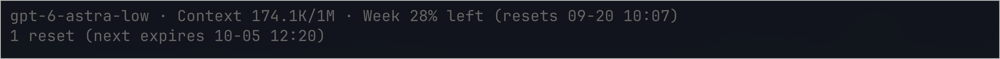

# Pi Codex Footer

English | [简体中文](README.zh-CN.md)

A quiet, compact footer for [Pi](https://pi.dev). See your model, reasoning level, context usage and Codex subscription limits without a wall of status text.



*Actual Ghostty screenshot supplied by the author. Model name, usage percentages and dates reflect that account at capture time; they are not promises about model availability or your subscription.*

## Install

Requires **Pi 0.85.1+** and **Node.js 22.13+**.

```sh
pi install git:github.com/adrianfrin/pi-codex-footer
```

Run `/reload` in Pi. For Codex quota, select an `openai-codex` model and authenticate through Pi's `/login`.

Pin a release:

```sh
pi install git:github.com/adrianfrin/pi-codex-footer@v0.1.0
```

Disable any other extension that replaces Pi's footer before enabling this one. If you previously installed the single-file `codex-footer.ts` version, remove or move it outside the extensions directory first; do not load both.

## What it shows

| Field | Meaning |
| --- | --- |
| `model-low` | Model ID with the current reasoning level appended; no redundant “Thinking” label |
| `Context 174.1K/1M` | Current context tokens / context window, not lifetime token totals |
| `5h 80% left (resets 09-20 10:07)` | Remaining five-hour allowance and its reset time, when returned |
| `Week 28% left (resets 09-20 10:07)` | Remaining weekly allowance and its reset time, when returned |
| `1 reset (next expires 10-05 12:20)` | Available manual reset credits and the earliest known expiration |

- Missing quota windows and unavailable reset-credit data are **hidden**, not guessed as zero or 100%.
- A known zero credit count is shown as `0 resets`. Unknown expiration times are omitted.
- Dates use your machine's **local timezone**, formatted `MM-DD HH:mm`.
- Models without reasoning support have no reasoning suffix. Non-Codex providers show model/context only.
- Low remaining quota and high context usage use warning colors from your current Pi theme.
- Long footers wrap at field boundaries; individual fields are truncated when wider than the terminal.
- Pi may not know context usage yet; that field can show `?` until usage is available.

Some accounts expose only a weekly window, even in the API's `primary_window` slot. The footer uses the reported duration, so that window is displayed as **Week**, not 5h.

## Refresh

Data is fetched when the interactive session starts, after model changes, and every **60 seconds**.

```text
/quota-refresh
```

This command explicitly refreshes the footer and reports partial/request failures. Automatic failures hide unavailable quota fields instead of filling the footer with error text. It does not consume a reset credit.

Cached values can remain visible until the next refresh. In-flight results are discarded after session/model changes, and active-account authentication is revalidated before publishing results. Request controllers and the timer are cleaned up when the session shuts down or reloads.

## Privacy and safety

- Only **read-only GET** requests to the official ChatGPT usage and reset-credit endpoints are made.
- This extension **never consumes a reset**, submits prompts, or modifies conversations.
- Authentication is resolved through Pi and the pinned `@narumitw/pi-usage` helper dependency. No API key needs to be pasted into this extension.
- No credentials or quota responses are saved by this extension, and no telemetry is collected.
- Codex subscription data is shown only for the `openai-codex` provider. Custom aliases and API-key billing are not supported as quota sources.
- These backend endpoints and upstream helper interfaces may change. An unavailable response is not evidence of zero remaining quota.

The upstream usage helpers are imported as a library; their extension is **not registered**, so installing this package does not also register upstream commands. You do not need to install `@narumitw/pi-usage` separately. If you also use it independently, both extensions may poll usage separately.

## Development

```sh
npm ci --ignore-scripts
npm run check
pi -e ./src/index.ts
```

`@narumitw/pi-usage` is pinned because the package uses its internal TypeScript helpers. Review compatibility before updating that dependency. Production dependencies are installed by Pi for Git installs; the upstream helper package is also bundled for npm packaging.

Tests cover token/model formatting, hidden missing fields, weekly-primary windows, model-specific quota selection, expiration ordering, narrow terminal rendering and lifecycle cleanup. Tests use fixtures and make no authenticated requests. Tested locally on macOS/Ghostty; other terminals and platforms have not been fully interactively verified.

The screenshot is checked into `docs/images/preview.png`. It is a real terminal capture, not an AI-generated mockup.

## Credits and license

MIT. Uses the MIT-licensed [`@narumitw/pi-usage`](https://github.com/narumiruna/pi-extensions/tree/main/packages/pi-usage) helpers for authentication, usage normalization, model quota selection and reset-credit queries. Dependency licenses remain with their respective authors.

Independent community project; not affiliated with OpenAI or the Pi maintainers.
