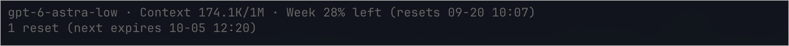

# Pi Codex Footer

[English](README.md) | 简体中文

为 [Pi](https://pi.dev) 提供简洁、低干扰的状态栏。直接查看模型、思考级别、上下文用量和 Codex 订阅额度，无需阅读冗长的状态信息。



*作者提供的 Ghostty 真实截图。模型名称、剩余额度和日期均为截图时该账号的状态，不代表对模型可用性或你的订阅权益作出承诺。*

## 安装

需要 **Pi 0.85.1+** 和 **Node.js 22.13+**。

```sh
pi install git:github.com/adrianfrin/pi-codex-footer
```

在 Pi 中执行 `/reload`。如需显示 Codex 额度，请选择 `openai-codex` 模型，并通过 Pi 的 `/login` 登录。

安装固定版本：

```sh
pi install git:github.com/adrianfrin/pi-codex-footer@v0.1.0
```

启用前请停用其他会替换 Pi 状态栏的扩展。如果之前安装过单文件版 `codex-footer.ts`，请先删除它或将它移到扩展目录之外，不要同时加载两个版本。

## 显示内容

| 字段 | 含义 |
| --- | --- |
| `model-low` | 模型 ID 后附当前思考级别，不再重复显示 “Thinking” 标签 |
| `Context 174.1K/1M` | 当前上下文 token 数 / 上下文窗口大小，不是会话累计用量 |
| `5h 80% left (resets 09-20 10:07)` | 五小时额度剩余比例及重置时间，仅在接口返回时显示 |
| `Week 28% left (resets 09-20 10:07)` | 周额度剩余比例及重置时间，仅在接口返回时显示 |
| `1 reset (next expires 10-05 12:20)` | 可用手动重置次数，以及其中最早的已知到期时间 |

- 未返回的额度窗口、无法获取的重置次数会直接**隐藏**，不会猜测为零或 100%。
- 已确认的零次重置显示为 `0 resets`。未知到期时间不显示。
- 时间使用本机的**当地时区**，格式为 `MM-DD HH:mm`。
- 不支持思考的模型不附加思考级别；非 Codex 提供商只显示模型和上下文。
- 剩余额度较低或上下文占用较高时，使用当前 Pi 主题的警告色。
- 状态栏过长时按字段换行；单个字段宽于终端时进行截断。
- Pi 尚未获取上下文用量时，上下文字段可能暂时显示 `?`。

部分账号只返回周额度，即使该额度位于 API 的 `primary_window` 字段。状态栏依据接口报告的窗口时长显示，因此会标为 **Week**，而不是 5h。

## 刷新

在交互式会话启动、模型切换时查询，并每 **60 秒**刷新一次。

```text
/quota-refresh
```

该命令会主动刷新状态栏，并报告部分数据缺失或请求失败。自动刷新失败时直接隐藏不可用的额度字段，避免在状态栏堆积错误提示。此操作不会消耗重置次数。

缓存值可能保留到下一次刷新。会话或模型发生变化后，在途请求结果将被丢弃；展示结果前会再次核对当前账号的认证信息。会话关闭或重新加载时会清理请求控制器和定时器。

## 隐私与安全

- 只向官方 ChatGPT 用量和重置次数接口发送**只读 GET 请求**。
- 插件**绝不会消耗重置次数**、提交提示词或修改对话。
- 通过 Pi 和固定版本的 `@narumitw/pi-usage` 辅助依赖解析认证信息，不需要向插件粘贴 API Key。
- 插件不保存凭据或额度响应，也不收集遥测数据。
- 仅对 `openai-codex` 提供商展示 Codex 订阅数据；自定义提供商别名和 API Key 计费不作为额度来源。
- 后端接口和上游辅助函数可能变动。无法获取响应不代表剩余额度为零。

上游用量辅助函数仅作为库导入，**不会注册上游扩展**，因此安装本包不会同时添加上游命令。无需单独安装 `@narumitw/pi-usage`。如果另外独立使用它，两个扩展可能分别轮询用量。

## 开发

```sh
npm ci --ignore-scripts
npm run check
pi -e ./src/index.ts
```

由于使用了内部 TypeScript 辅助函数，`@narumitw/pi-usage` 固定为精确版本。更新依赖前请检查兼容性。Git 安装时由 Pi 安装生产依赖；用于 npm 分发时也会打包上游辅助库。

测试涵盖 token 和模型格式、隐藏缺失字段、主窗口为周额度的情况、模型专属额度选择、到期时间排序、窄终端渲染和生命周期清理。测试使用模拟数据，不发送需要认证的请求。已在 macOS/Ghostty 本地测试；其他终端和平台尚未完成全面交互验证。

截图位于 `docs/images/preview.png`，来自真实终端，并非 AI 生成的效果图。

## 致谢与许可证

MIT。使用 MIT 许可的 [`@narumitw/pi-usage`](https://github.com/narumiruna/pi-extensions/tree/main/packages/pi-usage) 辅助函数，完成认证、用量归一化、模型额度选择和重置次数查询。依赖的许可证及著作权归各自作者所有。

独立社区项目，与 OpenAI 或 Pi 维护者没有隶属关系。
